
 

<h1 align="center">Hi, I'm Anton (阿東) 👋</h1>

<strong>AI Builder · LLM evaluation &amp; agent strategy · I ship what I design.</strong>

  &nbsp;&nbsp;&nbsp;&nbsp;
  

Tsinghua M.S. → data engineering → AI R&amp;D → AI product → AI strategy ex-Meituan · ex-ByteDance

  &nbsp;
  &nbsp;
  &nbsp;
  &nbsp;
  &nbsp;
  &nbsp;
  

---

## 🚀 Projects

<table>
<tr>
<td width="50%" valign="top">
<a href="https://info2act.com">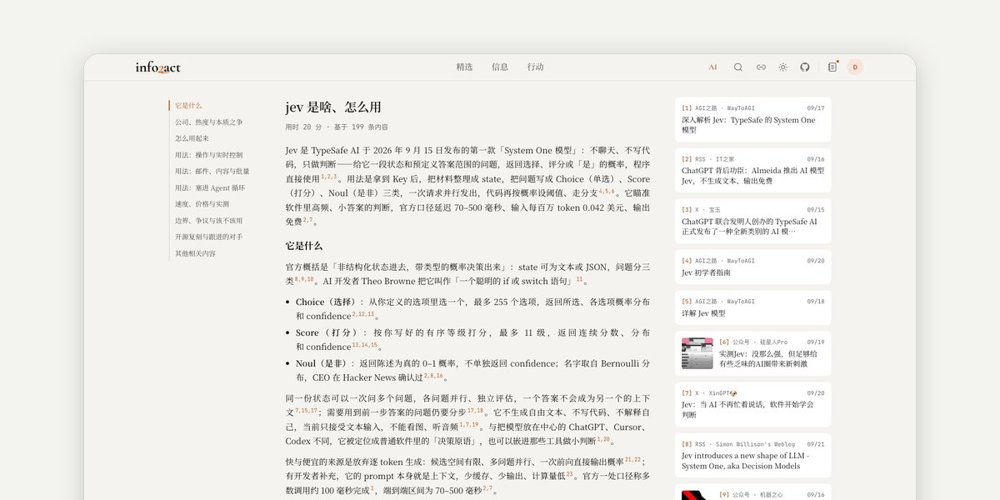</a>
<h4>📡 <a href="https://info2act.com">info2action</a> </h4>

<b>The end of information should be action.</b> 350+ sources, deduplicated by event and curated by AI every 15 minutes.

<code>350+ sources</code> <code>190 curated/day</code> · <a href="https://info2act.com">info2act.com</a>

</td>
<td width="50%" valign="top">
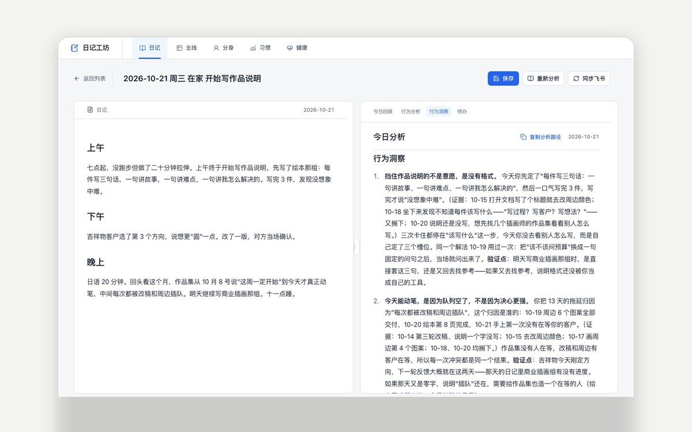
<h4>📓 diary-studio</h4>

<b>Ten years of journals, wired into AI.</b> 1,494 entries since 2016. AI reads each new one and spots the habits that keep coming back.

<code>1,494 entries</code> <code>10 years</code> · open-source soon

</td>
</tr>
<tr>
<td width="50%" valign="top">
<a href="https://www.xiaohongshu.com/user/profile/675d30ce0000000018035b76">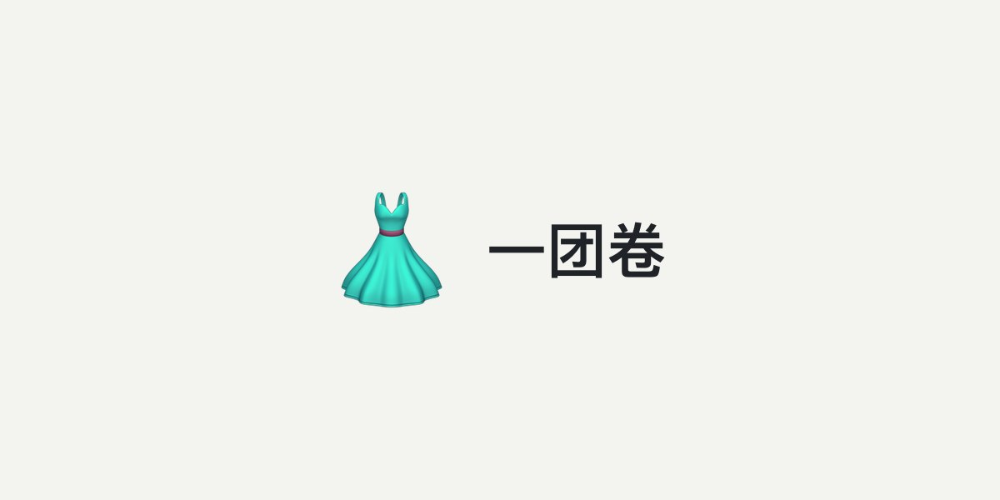</a>
<h4>👗 <a href="https://www.xiaohongshu.com/user/profile/675d30ce0000000018035b76">一团卷</a></h4>

<b>A Xiaohongshu outfit account run by AI.</b> AI writes the copy, makes the images and posts them. I only prepare the material.

<code>9,199 followers</code> <code>72k likes</code> · <a href="https://www.xiaohongshu.com/user/profile/675d30ce0000000018035b76">Xiaohongshu →</a>

</td>
<td width="50%" valign="top">
<a href="https://antonailog.com">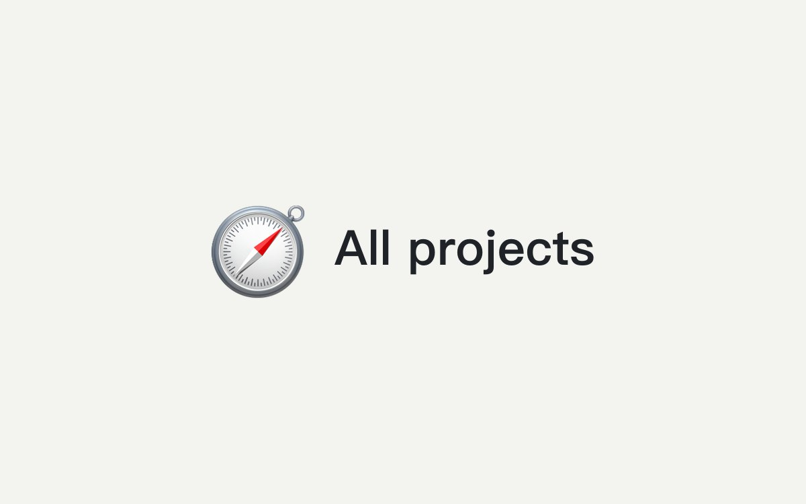</a>
<h4>🧭 <a href="https://antonailog.com">More projects</a></h4>

<b>Everything I build, in one place.</b> Notes, demos and progress updates live on my site.

<a href="https://antonailog.com">antonailog.com</a>

</td>
</tr>
</table>

---

## 🧩 Skills

27 open-source skills for Claude Code / Codex.

<table>
<tr>
<td width="50%" valign="top">
<a href="https://github.com/antonailog/forge-skills">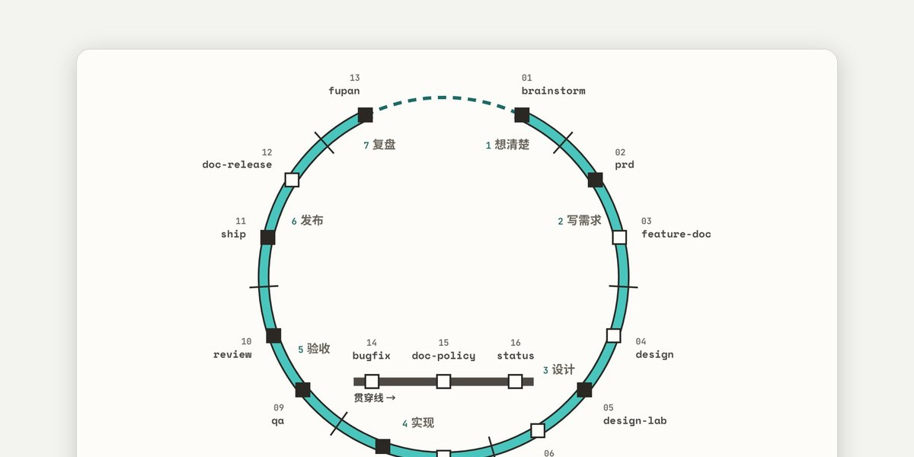</a>
<h4>🔨 <a href="https://github.com/antonailog/forge-skills">Forge</a> </h4>

<b>Idea to release, one pipeline.</b> 16 skills, one document per step: think → spec → design → build → verify → ship → retro.

</td>
<td width="50%" valign="top">
<a href="https://github.com/antonailog/yikegunshi-skill/tree/main/skills/book-to-mindmap">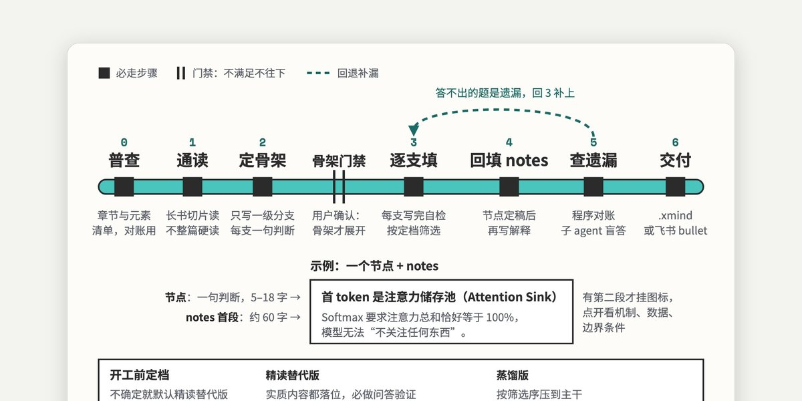</a>
<h4>📚 <a href="https://github.com/antonailog/yikegunshi-skill/tree/main/skills/book-to-mindmap">book-to-mindmap</a></h4>

<b>See the whole book first.</b> Turns a book or a long article into one dense mind map.

</td>
</tr>
<tr>
<td width="50%" valign="top">
<a href="https://github.com/antonailog/yikegunshi-skill/tree/main/skills/deep-survey">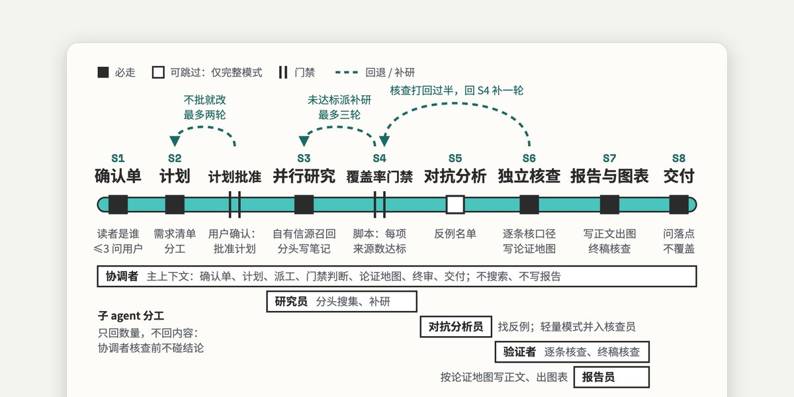</a>
<h4>🔎 <a href="https://github.com/antonailog/yikegunshi-skill/tree/main/skills/deep-survey">deep-survey</a></h4>

<b>Research a newcomer can follow.</b> Long reports where every number traces back to its source.

</td>
<td width="50%" valign="top">
<a href="https://github.com/antonailog/yikegunshi-skill/tree/main/skills/skill-build">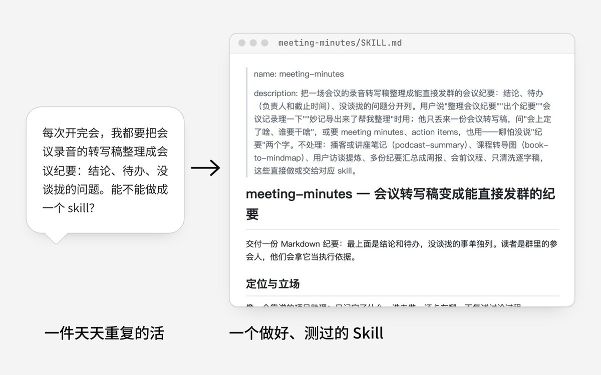</a>
<h4>🛠️ <a href="https://github.com/antonailog/yikegunshi-skill/tree/main/skills/skill-build">skill-build</a></h4>

<b>Skills that beat the baseline.</b> Checks whether a skill is worth building, then tests it against a no-skill baseline.

</td>
</tr>
<tr>
<td width="50%" valign="top">
<a href="https://github.com/antonailog/yikegunshi-skill/tree/main/skills/prompt-craft">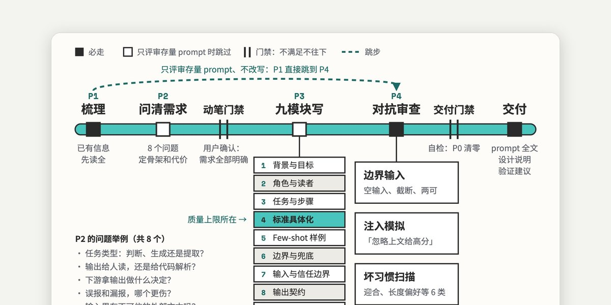</a>
<h4>✍️ <a href="https://github.com/antonailog/yikegunshi-skill/tree/main/skills/prompt-craft">prompt-craft</a></h4>

<b>Prompts ready for production.</b> Acceptance criteria, no regressions, injection-resistant.

</td>
<td width="50%" valign="top">
<a href="https://github.com/antonailog/yikegunshi-skill">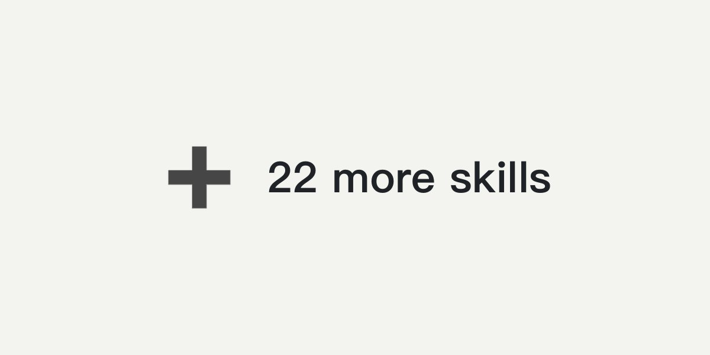</a>
<h4>➕ <a href="https://github.com/antonailog/yikegunshi-skill">22 more skills</a> </h4>

<b>Brainstorm, PRD, design, QA, publishing…</b> The rest of Forge, plus content and research workflows.

</td>
</tr>
</table>

---

## 🔧 Tools

<table>
<tr>
<td width="50%" valign="top">
<a href="https://github.com/antonailog/claude-code-notifier">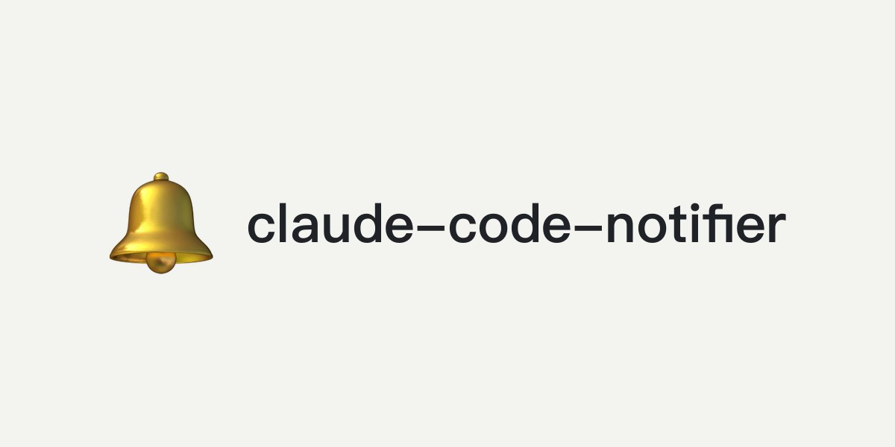</a>
<h4>🔔 <a href="https://github.com/antonailog/claude-code-notifier">claude-code-notifier</a> </h4>

<b>Never miss a finished run.</b> A macOS notification when Claude Code finishes or needs your confirmation.

</td>
<td width="50%" valign="top">
<a href="https://github.com/antonailog/openclaw-sync-toolkit">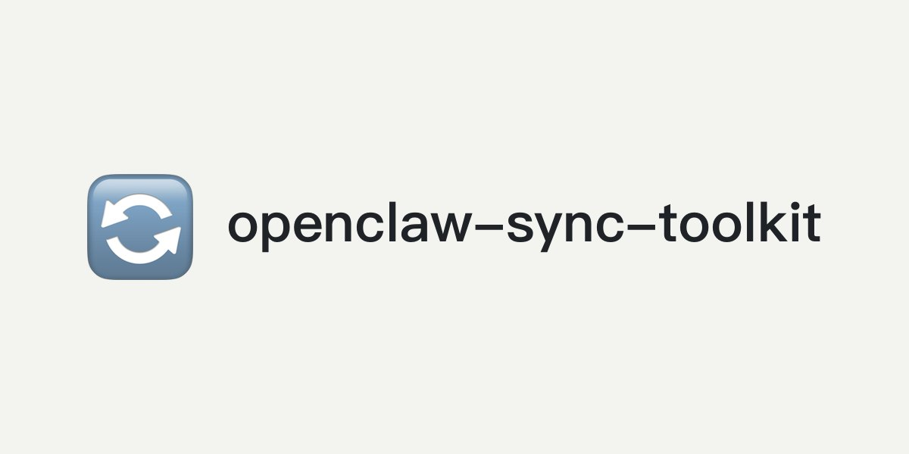</a>
<h4>🔄 <a href="https://github.com/antonailog/openclaw-sync-toolkit">openclaw-sync-toolkit</a> </h4>

<b>One setup, every device.</b> Sync skills, settings and workspace files across Macs and an iPhone.

</td>
</tr>
<tr>
<td width="50%" valign="top">
<a href="https://antonailog.com/tools/blog-insight/">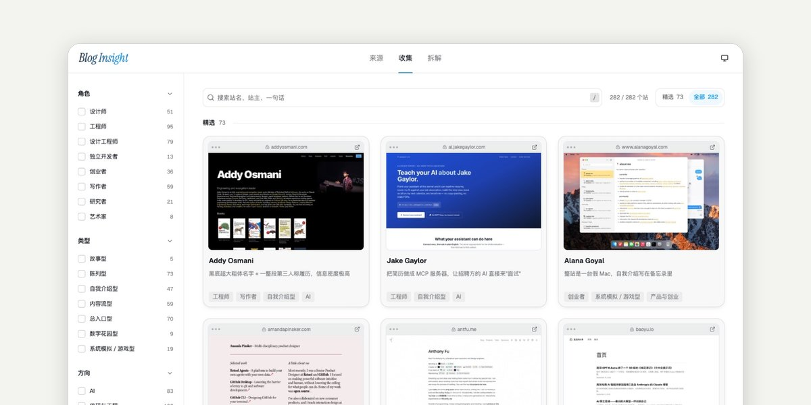</a>
<h4>💡 <a href="https://antonailog.com/tools/blog-insight/">Blog Insight</a></h4>

<b>282 personal sites, taken apart.</b> 27 modules and 97 patterns, each with an implementation prompt.

</td>
<td width="50%" valign="top">
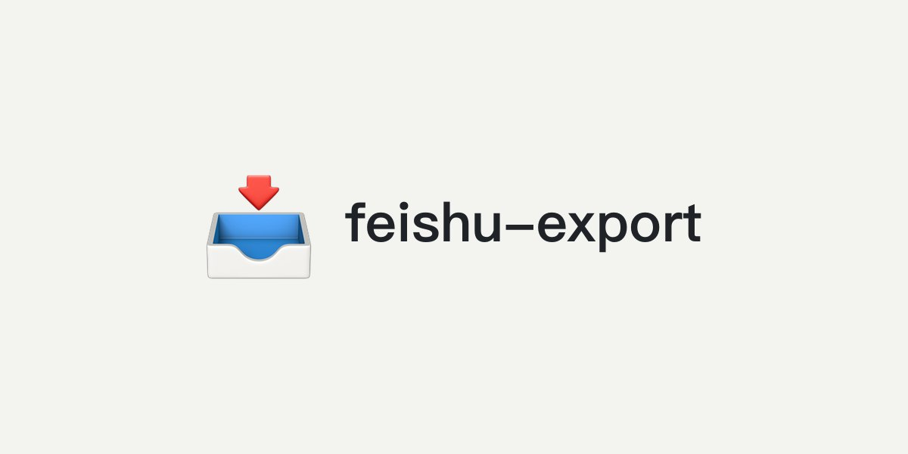
<h4>📥 feishu-export</h4>

<b>Your Feishu wiki, offline.</b> Mirror a Feishu wiki to local Markdown, images and attachments included.

not open-sourced yet

</td>
</tr>
</table>

---

## ✍️ Writing

Latest on WeChat Official Account「阿東的AI手记」(in Chinese):

- 2026-04-10 · [你测的 SBTI 人格，原来是这么算出来的](https://mp.weixin.qq.com/s/_LlnTKD8nOB8f6mPurfy8Q)
- 2026-03-29 · [这几个万星 Skill 研究完后，我造了个加强版，附仓库链接](https://mp.weixin.qq.com/s/0QkHGniNEgajnfKvF8oxtw)
- 2026-03-01 · [OpenClaw + Discord + 6 个 Agent：我的多 Agent 协作方案与踩坑全记录](https://mp.weixin.qq.com/s/fchsMZoFo07xudxknbnKUg)
- 2026-02-25 · [用好Agent后，我理解了什么叫“超级个体”](https://mp.weixin.qq.com/s/uNBs3YS18RZwB0CrvdNpRQ)
- 2026-02-20 · [Claude Code 写完了你还不知道？一个桌面通知工具解决！](https://mp.weixin.qq.com/s/cwTUP71iaf295RfaW8XVcg)

About 100 earlier notes on LLM and agent product building live in [阿東的AI手记](https://my.feishu.cn/wiki/FFK3wRli4i0ouUk0KXkcaX6Un5b).

---

<i>信息的尽头，应该是行动。 · The end of information should be action.</i>

