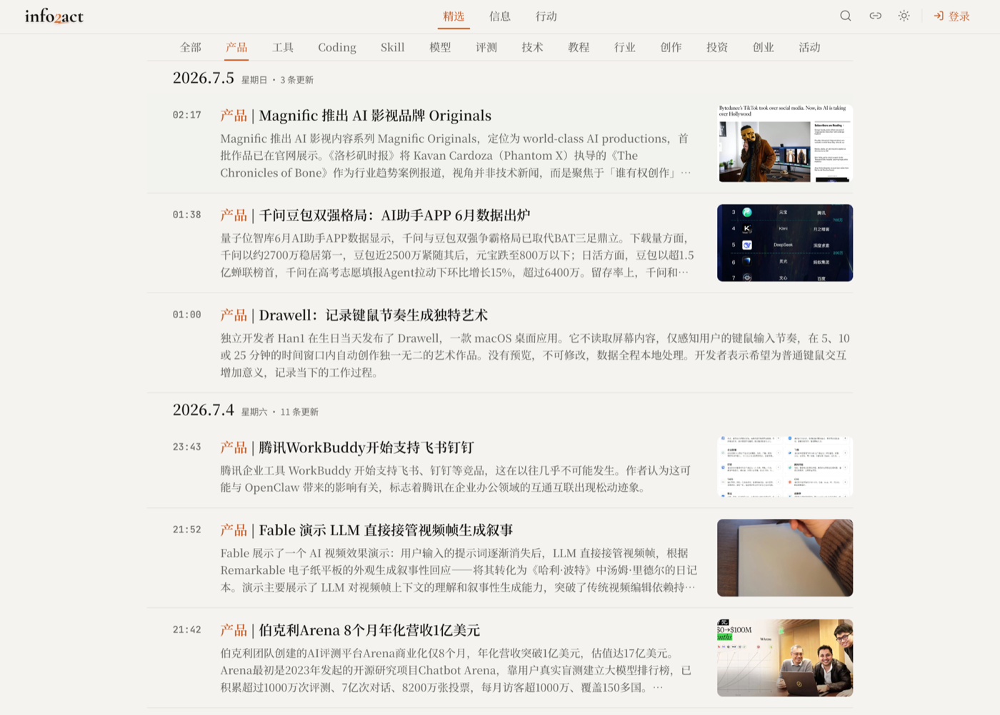

# Boden

**AI 产品经理 @ 字节跳动（抖音搜索）· LLM 评测与 Agent 策略 · 自己设计的东西，自己做出来。**

[LinkedIn](https://www.linkedin.com/in/%E6%BB%9A%E7%9F%B3-%E4%B8%80%E9%A2%97-5709b2430/) · [info2act.com](https://info2act.com) · 公众号「超级个体阿东」 · **[English →](README.md)**

## 🔭 正在做

**[info2action](https://github.com/yike-gunshi/info2action)** —— *「信息的尽头，应该是行动。」*
可自部署的 AI 信息引擎：400+ 信源（X、Reddit、公众号、Hacker News…）→ LLM 过滤 / 去重 / 事件聚类 → 每日 150+ 精选事件，15 分钟更新一次。线上版 **[info2act.com](https://info2act.com)**，产品定义、设计、开发、部署、运营一人完成（Claude Code + Codex + 自建 skills）。

## ⭐ 项目

**产品**

- [info2action](https://github.com/yike-gunshi/info2action)  —— 上面这个：多源聚合 → 跨源事件去重 → AI 精选 → 信息转行动

**框架与 Skill**

- [forge-skills](https://github.com/yike-gunshi/forge-skills)  —— 文档驱动的 AI 开发框架，14 个 skill 覆盖头脑风暴 → PRD → 设计 → 工程 → QA → 发布
- [yikegunshi-skill](https://github.com/yike-gunshi/yikegunshi-skill) —— Claude Code / Codex 实用 skill 集：内容工作流、PRD 分析、知识库镜像
- [prompt-vault](https://github.com/yike-gunshi/prompt-vault) —— 生产级 prompt 资产库，六分类 + 自动索引

**工具**

- [claude-code-notifier](https://github.com/yike-gunshi/claude-code-notifier)  —— Claude Code 的 macOS 通知工具，带 AI 会话摘要
- [openclaw-sync-toolkit](https://github.com/yike-gunshi/openclaw-sync-toolkit)  —— 多台 Mac + iPhone 间同步 Claude Code 的 skill 与配置（Git + Syncthing 双通道）

**实验**

- 小红书 AI 内容账号 —— LLM + SOTA 文生图 + n8n，95% 全自动流水线：50 天产出 150+ 篇笔记，峰值粉丝 1w

## ✍️ 写作

LLM / Agent 产品方向文章近百篇 → [Boden 的 AI 宝库](https://my.feishu.cn/wiki/FFK3wRli4i0ouUk0KXkcaX6Un5b) · 公众号「超级个体阿东」

## 🏃 屏幕之外

晨跑 4 年 · 日记复盘 10 年 · 摄影

> 信息的尽头，应该是行动。
