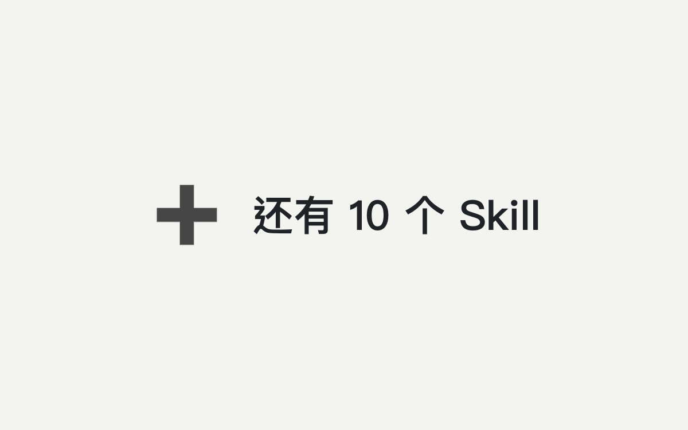
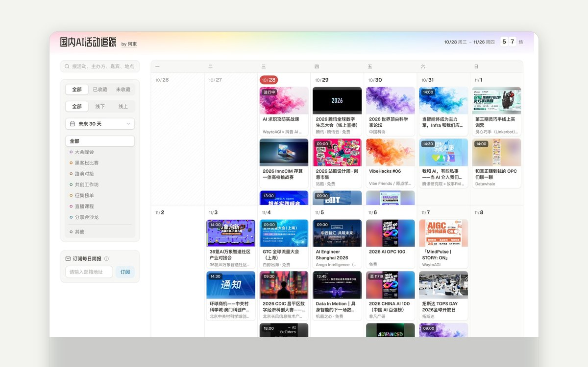

 

<h1 align="center">你好，我是阿東Anton 👋</h1>

<strong>AI Builder · LLM 评测与 Agent 策略 · 自己设计的东西，自己做出来。</strong>

  &nbsp;&nbsp;&nbsp;&nbsp;
  

清华硕士 → 数据研发 → AI 研发 → AI 产品 → AI 策略 ex 美团 · ex 字节

  &nbsp;
  &nbsp;
  &nbsp;
  &nbsp;
  &nbsp;
  &nbsp;
  

---

## 🚀 项目

<table>
<tr>
<td width="50%" valign="top">

<h4>📡 <a href="https://info2act.com">info2action</a> </h4>

<b>信息的尽头，应该是行动。</b> 从 X、公众号、RSS、Reddit 等 350 多个信源抓取，按事件去重、AI 精选和总结，每 15 分钟更新；看到有用的，一键转成能执行的行动。已上线并开源。

<code>350+ 信源</code> <code>每天精选 190 条</code> · <a href="https://info2act.com">info2act.com</a> · <a href="https://antonailog.com/projects/#info2action">详细介绍 →</a>

</td>
<td width="50%" valign="top">

<h4>📓 diary-studio</h4>

<b>十年日记，接进 AI 做复盘。</b> 2016 年至今的 1,494 篇日记。每天写完让 AI 读一遍，结合最近 30 天，指出反复出现的模式、提了好几次还没动的事，给出能验证的下一步。

<code>1,494 篇日记</code> <code>10 年</code> · 在准备开源版 · 截图为模拟数据 · <a href="https://antonailog.com/projects/#diary-studio">详细介绍 →</a>

</td>
</tr>
<tr>
<td width="50%" valign="top">

<h4>👗 <a href="https://www.xiaohongshu.com/user/profile/675d30ce0000000018035b76">小红书 AIGC 账号</a></h4>

<b>全 AI 运营的穿搭账号「一团卷」。</b> Claude、Gemini 写文案，Nano Banana Pro、Seedream 出图，n8n 和影刀自动发布，我只准备素材。50 天发了 150 多篇。

<code>9,177 粉丝</code> <code>7.1 万赞藏</code> · <a href="https://antonailog.com/projects/#yituanjuan">详细介绍 →</a>

</td>
<td width="50%" valign="top">

<h4>🧭 <a href="https://antonailog.com/projects/">全部项目</a></h4>

<b>每个项目背后的经过。</b> 为什么做、做了什么、怎么做的、做下来的想法，配演示录屏。

<a href="https://antonailog.com/projects/">antonailog.com/projects</a>

</td>
</tr>
</table>

---

## 🧩 Skill

31 个开源 Skill，给 Claude Code / Codex 用，分五类：AI 编程、AI 设计、知识整理、写作发布、Skill 与 Prompt。[在网站上看全部 →](https://antonailog.com/skills/)

<table>
<tr>
<td width="50%" valign="top">

<h4>🔨 <a href="https://github.com/antonailog/forge-skills">Forge</a> </h4>

<b>16 个 Skill + 1 个总入口，从一句想法到上线。</b> 想清楚、写需求、设计、写代码、验收、审查、发布、修 bug、复盘，每一步交出一份文档，下一步照着做。示范：一句「我想做一个番茄钟网页」做到合并上线。

<a href="https://github.com/antonailog/forge-demo-pomodoro">示范仓库</a> · <a href="https://antonailog.com/skills/#forge">详细介绍 →</a>

</td>
<td width="50%" valign="top">

<h4>🔎 <a href="https://github.com/antonailog/skills/tree/main/skills/deep-survey">deep-survey</a></h4>

<b>读完就能做决定的调研报告。</b> 研究员分头查一手资料，没参与查资料的主笔成文，独立审读员核对结论；每个关键数字都能点回原文。

<a href="https://antonailog.com/skills/#deep-survey">详细介绍 →</a>

</td>
</tr>
<tr>
<td width="50%" valign="top">

<h4>📚 <a href="https://github.com/antonailog/skills/tree/main/skills/book-to-mindmap">book-to-mindmap</a></h4>

<b>把一本书压成一张导图。</b> 每个节点写成一句能判断对错的话；最后让没读过原书的 AI 只看导图答题，答不上的地方回头补。

<a href="https://antonailog.com/skills/#book-to-mindmap">详细介绍 →</a>

</td>
<td width="50%" valign="top">

<h4>🛠️ <a href="https://github.com/antonailog/skills/tree/main/skills/skill-build">skill-build</a></h4>

<b>把重复的活做成测过的 Skill。</b> 先判断值不值得做，出设计文档过检查再写 SKILL.md；用和不用各跑几遍对比，按差在哪去改。

<a href="https://antonailog.com/skills/#skill-build">详细介绍 →</a>

</td>
</tr>
<tr>
<td width="50%" valign="top">

<h4>✍️ <a href="https://github.com/antonailog/skills/tree/main/skills/prompt-craft">prompt-craft</a></h4>

<b>写能上线的 prompt。</b> 九个模块的固定结构加一份审查清单，拿边界输入、注入和模型的常见坏毛病逐项挑错。

<a href="https://antonailog.com/skills/#prompt-craft">详细介绍 →</a>

</td>
<td width="50%" valign="top">

<h4>➕ <a href="https://github.com/antonailog/skills">还有 10 个 Skill</a> </h4>

<b>播客、论文、小红书、公众号……</b> 播客笔记、论文卡片、知识画布、飞书镜像、小红书笔记、公众号发布、产品文档、跟随鼠标的 3D 头像、派活给 Codex、prompt 库。

<a href="https://antonailog.com/skills/">全部 31 个，按类看</a>

</td>
</tr>
</table>

---

## 🔧 工具

<table>
<tr>
<td width="50%" valign="top">

<h4>🔔 <a href="https://github.com/antonailog/claude-code-notifier">claude-code-notifier</a> </h4>

<b>跑完了不会错过。</b> Claude Code 跑完或需要你确认时弹 macOS 通知，副标题是 AI 写的会话摘要，开好几个会话也分得清是哪个好了。

</td>
<td width="50%" valign="top">

<h4>🔄 <a href="https://github.com/antonailog/openclaw-sync-toolkit">openclaw-sync-toolkit</a> </h4>

<b>一次配置，处处同步。</b> Git 管配置，Syncthing 管工作区文件，Skill、设置和文档在多台 Mac 和 iPhone 之间自动同步；部署一次就在后台跑。

</td>
</tr>
<tr>
<td width="50%" valign="top">

<h4>💡 <a href="https://antonailog.com/tools/blog-insight/">Blog Insight</a></h4>

<b>拆开 282 个个人网站。</b> 按 27 个模块拆成 97 种做法，每种附实现提示词。我的网站每个模块都先在这里比过做法。

</td>
<td width="50%" valign="top">

<h4>📅 <a href="https://antonailog.com/more/ai-events/">国内AI活动追踪</a></h4>

<b>国内 AI 活动，一页看全。</b> 大会、黑客松、路演和沙龙按日历和时间线排好，可按城市、形式、分类筛选，每天更新。

</td>
</tr>
</table>

---

## ✍️ 文章

最近几篇，同步发在公众号「阿東的AI手记」。[全部文章 →](https://antonailog.com/posts/)

- 2026-04-10 · [你测的 SBTI 人格，原来是这么算出来的](https://antonailog.com/posts/2026-04-10/)
- 2026-03-29 · [这几个万星 Skill 研究完后，我造了个加强版，附仓库链接](https://antonailog.com/posts/2026-03-29/)
- 2026-03-01 · [OpenClaw + Discord + 6 个 Agent：我的多 Agent 协作方案与踩坑全记录](https://antonailog.com/posts/2026-03-01/)
- 2026-02-25 · [用好Agent后，我理解了什么叫“超级个体”](https://antonailog.com/posts/2026-02-25/)
- 2026-02-20 · [Claude Code 写完了你还不知道？一个桌面通知工具解决！](https://antonailog.com/posts/2026-02-20/)

更早的 LLM / Agent 产品笔记近百篇，收在[阿東的AI手记](https://my.feishu.cn/wiki/FFK3wRli4i0ouUk0KXkcaX6Un5b)。

---

<i>信息的尽头，应该是行动。</i>

